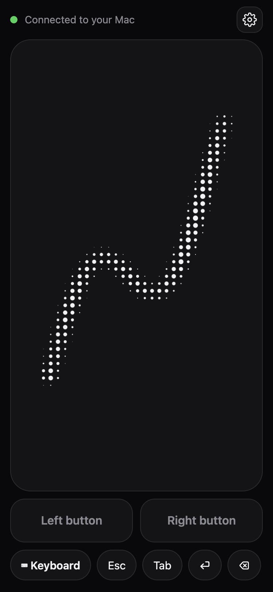
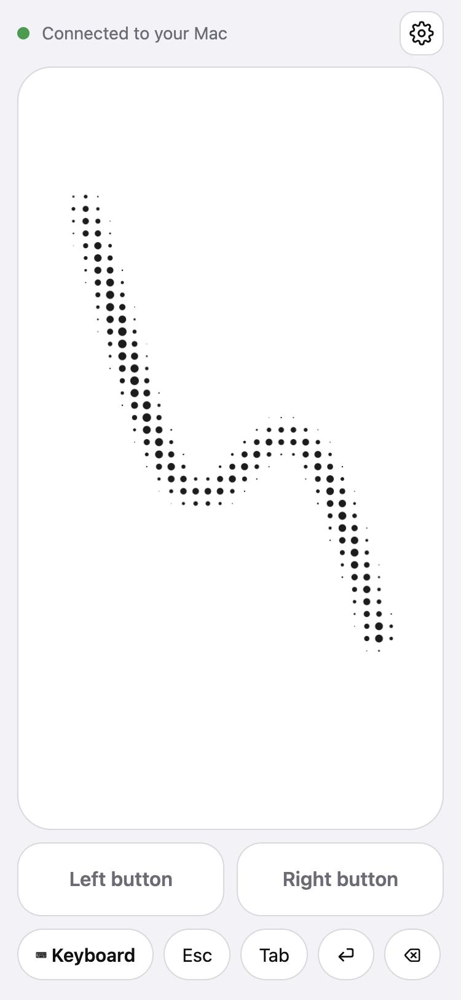
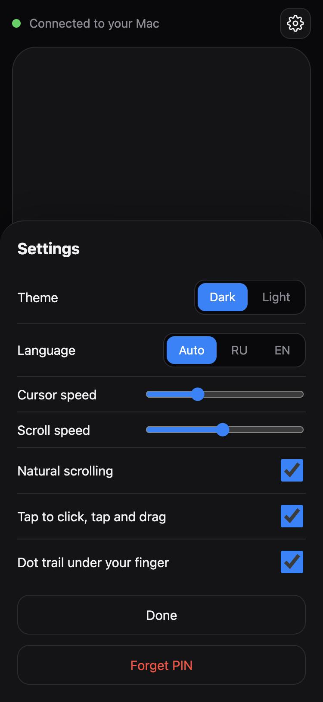

<p align="center">
  
</p>

<p align="center"><b>English</b> · <a href="README.ru.md">Русский</a></p>

# iPhone Touchpad

Use your iPhone as a wireless trackpad and keyboard for your Mac. There is nothing to install on the phone: open a web page in Safari and your finger moves the Mac's cursor.

- Move the cursor, tap to click, scroll with two fingers, two-finger tap for right click, tap-and-drag
- Left and right buttons you can hold while moving with another finger
- The iPhone keyboard (any language) plus Esc, arrows, ⌘C / ⌘V / ⌘Tab, Mission Control and Spaces
- Dark and light themes, English and Russian interface, a soft halftone dot trail under your finger
- One Python file, standard library only, no `pip install`
- Protected by a PIN

<p align="center">
  
  &nbsp;
  
  &nbsp;
  
</p>

## Requirements

- A Mac with Python 3.9 or newer. The Python from Apple's command line tools works; if `python3` is missing, macOS offers to install it the first time you run it.
- An iPhone (or any phone or tablet with a browser) on the **same Wi-Fi network** as the Mac.

## Quick start

1. Download this folder (or `git clone` it) and open Terminal in it. Do not keep it in Downloads, Desktop or Documents if you want autostart later.
2. Run the server:

   ```bash
   python3 server.py --open --prompt
   ```

   You can also double-click `start.command`.
3. macOS asks to let the app that runs the server (Terminal) control the computer. In **System Settings → Privacy & Security → Accessibility** switch it on, then run the command again.
4. A page opens on the Mac with a QR code and a PIN. Scan the code with the iPhone camera, open the link in Safari and enter the PIN once. The phone remembers it for good.
5. Optional: in Safari tap **Share → Add to Home Screen** to get an app-like icon that opens full screen. The QR code opens the Mac's `.local` name (for example `http://YourMac.local:8899/`), which stays the same on every Wi-Fi network, so the icon keeps working when the network changes. Both devices just need to be on the same network.

### Start at login

To have the server start by itself whenever you log in to your Mac:

```bash
./install-autostart.sh
```

It installs a LaunchAgent, prints your PIN and opens the Accessibility settings: switch on **Python** there, then restart the server with the command it prints. From then on you only open the icon on your phone. Remove it with `./uninstall-autostart.sh`.

### Menu bar icon

For a small icon next to the battery (needs the Xcode command line tools: `xcode-select --install`):

```bash
./install-menubar.sh
```

Click it to see whether a phone is connected, copy the PIN or the address, open the QR code page or restart the server. It starts at every login. Remove it with `./uninstall-menubar.sh`. The icon only reads `http://127.0.0.1:8899/status` from the server and needs no macOS permissions of its own.

## Gestures

| Gesture | What it does |
| --- | --- |
| One finger | Moves the cursor (a faster finger travels further) |
| Tap | Left click |
| Tap, then touch again and drag | Drag. Without moving it is a double click |
| Two fingers | Scroll |
| Two-finger tap | Right click |
| Left / Right button | Hold to press, move with another finger to drag |

Settings (the gear icon): theme, language, cursor and scroll speed, natural scrolling, tap-to-click and the dot trail.

## How it works

The Mac runs a small HTTP + WebSocket server (`server.py`). Safari loads `index.html` from it and sends touch movements to the server as short JSON messages. The server turns them into mouse, scroll and key events using CoreGraphics (`CGEventPost`) through `ctypes`.

**Why not Bluetooth?** iOS does not let apps act as a Bluetooth mouse or keyboard (the HID role is closed to third-party apps), and Safari has no Web Bluetooth. Wi-Fi is the way that needs nothing installed on the phone.

## Security

- Anyone who knows the PIN and is on your network can control your Mac. The PIN is 6 random digits kept in `.pin` (it is in `.gitignore`). After 5 wrong attempts the server locks out PIN checks for a while, longer with each failure. After the first sign-in the phone gets a signed device token (stored in an HttpOnly cookie and in local storage), so it does not ask for the PIN again. Deleting `.pin` creates a new PIN and signs out every phone. WebSockets from other web pages are refused.
- Traffic is plain HTTP on your local network and is not encrypted. Use it on a Wi-Fi network you trust, and never forward the port to the internet.
- The server listens on all network interfaces, port 8899. Stop it with Ctrl+C or remove the autostart when you do not need it.
- The QR / PIN page (`/qr`) and `/status` are only served to the Mac itself, and only under `localhost` names, which also blocks DNS-rebinding tricks from web pages.

## Troubleshooting

- **The page does not open on the phone.** Check that both devices are on the same Wi-Fi (guest networks often isolate devices). If the macOS firewall is on, allow incoming connections for Python when it asks. Try the address printed in the terminal, or the `YourMac.local` name.
- **The page opens but the cursor does not move.** The app that runs the server needs Accessibility access: Terminal when started by hand, **Python** when started by autostart. Switch it on and restart the server.
- **The `.local` name does not open.** Some office and guest networks block it. Use the numeric address shown under the QR code (it changes with the network).
- **Scrolling goes the wrong way.** Toggle *Natural scrolling* in the settings.
- **Port 8899 is busy.** Start with another port: `TOUCHPAD_PORT=8900 python3 server.py`.
- **Forgot the PIN.** On the Mac open `http://localhost:8899/qr` in any browser (no Terminal needed, bookmark it), or double-click `start.command`. It is also the content of the `.pin` file. The PIN never changes unless you delete that file.

## Files

| File | Purpose |
| --- | --- |
| `server.py` | The server: HTTP, WebSocket, mouse and keyboard events |
| `index.html` | The touchpad page that opens on the phone |
| `qr.html` | The QR code and PIN page shown on the Mac |
| `assets/` | App icons |
| `docs/` | Images for this README |
| `tools/make_icons.py` | Regenerates the icons and banners (pure Python) |
| `start.command` | Double-click launcher |
| `install-autostart.sh`, `uninstall-autostart.sh` | Start the server at login |
| `menubar/Touchpad.swift` | The menu bar icon (Swift) |
| `install-menubar.sh`, `uninstall-menubar.sh` | Build and start the menu bar icon |

## Limitations

- macOS only. Windows and Linux need a different way of injecting events.
- Tested with Safari on iPhone and with Python 3.9 and 3.13.
- The Mac must be awake and on the same network.

## License

[MIT](LICENSE)
