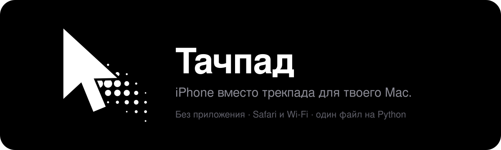
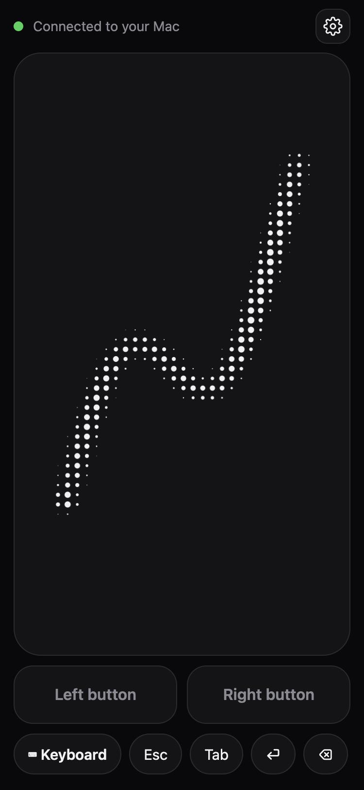
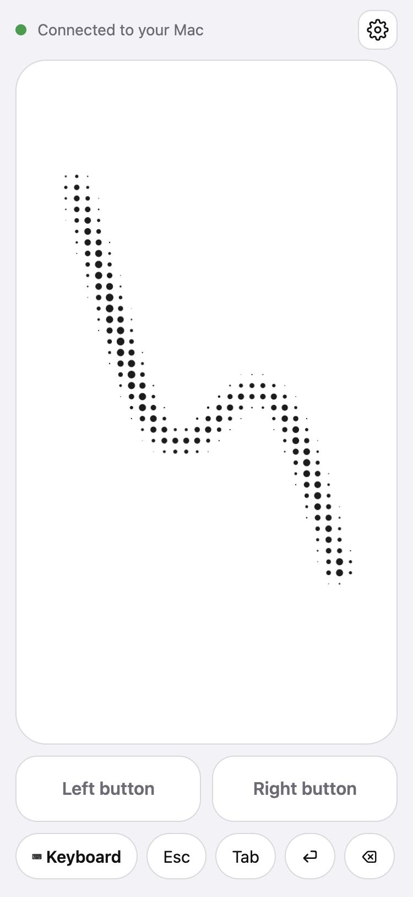
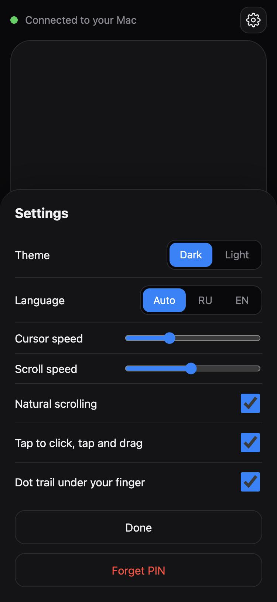

<p align="center">
  
</p>

<p align="center"><a href="README.md">English</a> · <b>Русский</b></p>

# Тачпад на iPhone

iPhone работает как беспроводной трекпад и клавиатура для твоего Mac. На телефон ничего ставить не нужно: открываешь страницу в Safari, и палец двигает курсор на компьютере.

- Курсор, тап как клик, прокрутка двумя пальцами, тап двумя пальцами как правый клик, перетаскивание
- Левая и правая кнопки: их можно держать, а двигать курсор другим пальцем
- Клавиатура iPhone (любой язык), а также Esc, стрелки, ⌘C / ⌘V / ⌘Tab, Mission Control и переключение столов
- Тёмная и светлая темы, интерфейс на русском и английском, мягкий точечный след под пальцем
- Один файл на Python, только стандартная библиотека, без `pip install`
- Защита PIN-кодом

<p align="center">
  
  &nbsp;
  
  &nbsp;
  
</p>

## Что нужно

- Mac с Python 3.9 или новее. Подойдёт Python из инструментов командной строки Apple; если `python3` нет, macOS сама предложит его установить при первом запуске.
- iPhone (или любой телефон или планшет с браузером) в **той же Wi-Fi сети**, что и Mac.

## Быстрый старт

1. Скачай папку (или `git clone`) и открой в ней Терминал. Если хочешь потом включить автозапуск, не держи её в Загрузках, на Рабочем столе или в Документах.
2. Запусти сервер:

   ```bash
   python3 server.py --open --prompt
   ```

   Можно просто дважды кликнуть по `start.command`.
3. macOS попросит разрешить приложению, из которого запущен сервер (Терминалу), управлять компьютером. Включи его в **Системные настройки → Конфиденциальность и безопасность → Универсальный доступ** и запусти команду ещё раз.
4. На Mac откроется страница с QR-кодом и PIN. Наведи камеру iPhone на код, открой ссылку в Safari и один раз введи PIN. Телефон его запомнит.
5. По желанию: в Safari нажми **Поделиться → На экран Домой**, и появится иконка, которая открывает тачпад на весь экран.

### Запуск при входе в систему

Чтобы сервер сам стартовал, когда ты входишь в Mac:

```bash
./install-autostart.sh
```

Скрипт установит автозапуск, покажет PIN и откроет настройки Универсального доступа: включи там **Python** и перезапусти сервер командой, которую скрипт выведет. Дальше достаточно открывать иконку на телефоне. Убрать автозапуск: `./uninstall-autostart.sh`.

## Жесты

| Жест | Что делает |
| --- | --- |
| Один палец | Двигает курсор (чем быстрее палец, тем дальше курсор) |
| Тап | Левый клик |
| Тап и сразу касание с движением | Перетаскивание. Без движения это двойной клик |
| Два пальца | Прокрутка |
| Тап двумя пальцами | Правый клик |
| Левая / Правая кнопка | Держи, чтобы зажать, и двигай другим пальцем для перетаскивания |

Настройки (значок шестерёнки): тема, язык, скорость курсора и прокрутки, натуральная прокрутка, тап как клик и точечный след.

## Как это устроено

На Mac работает небольшой HTTP и WebSocket сервер (`server.py`). Safari загружает с него `index.html` и отправляет движения пальцев короткими JSON-сообщениями. Сервер превращает их в события мыши, прокрутки и клавиш через CoreGraphics (`CGEventPost`) с помощью `ctypes`.

**Почему не Bluetooth?** iOS не позволяет приложениям работать как Bluetooth-мышь или клавиатура (роль HID закрыта для сторонних приложений), а в Safari нет Web Bluetooth. Wi-Fi остаётся способом, при котором на телефон ничего не нужно ставить.

## Безопасность

- Любой, кто знает PIN и находится в твоей сети, может управлять Mac. PIN состоит из 6 случайных цифр и хранится в файле `.pin` (он в `.gitignore`). После 5 неверных попыток сервер на время перестаёт принимать PIN, с каждой ошибкой всё дольше.
- Трафик идёт по обычному HTTP внутри локальной сети и не шифруется. Пользуйся доверенной Wi-Fi сетью и никогда не пробрасывай порт в интернет.
- Сервер слушает все сетевые интерфейсы, порт 8899. Останавливай его (Ctrl+C) или убирай автозапуск, когда он не нужен.
- Страница с QR-кодом и PIN (`/qr`) отдаётся только самому Mac.

## Если что-то не работает

- **Страница не открывается на телефоне.** Проверь, что оба устройства в одной Wi-Fi сети (гостевые сети часто разделяют устройства). Если на Mac включён брандмауэр, разреши входящие подключения для Python, когда система спросит. Попробуй адрес из терминала или имя вида `ИмяMac.local`.
- **Страница открывается, но курсор не двигается.** Приложению, которое запускает сервер, нужен Универсальный доступ: Терминалу при ручном запуске, **Python** при автозапуске. Включи его и перезапусти сервер.
- **Прокрутка идёт не в ту сторону.** Переключи «Натуральная прокрутка» в настройках.
- **Порт 8899 занят.** Запусти на другом порту: `TOUCHPAD_PORT=8900 python3 server.py`.
- **Забыл PIN.** Он лежит в файле `.pin`.

## Файлы

| Файл | Назначение |
| --- | --- |
| `server.py` | Сервер: HTTP, WebSocket, события мыши и клавиатуры |
| `index.html` | Страница тачпада, которая открывается на телефоне |
| `qr.html` | Страница с QR-кодом и PIN, показывается на Mac |
| `assets/` | Иконки приложения |
| `docs/` | Картинки для README |
| `tools/make_icons.py` | Пересобирает иконки и баннеры (чистый Python) |
| `start.command` | Запуск двойным кликом |
| `install-autostart.sh`, `uninstall-autostart.sh` | Запуск при входе в систему |

## Ограничения

- Только macOS. Для Windows и Linux нужен другой способ отправлять события.
- Проверено с Safari на iPhone и с Python 3.9 и 3.13.
- Mac должен быть включён и в той же сети.

## Лицензия

[MIT](LICENSE)
